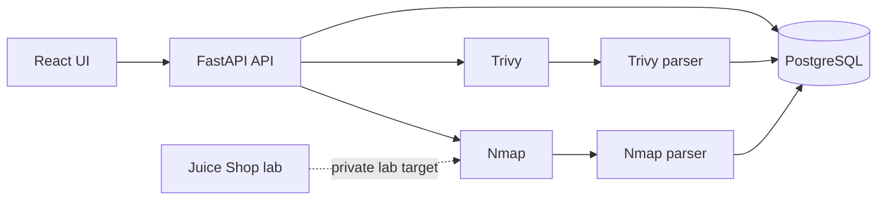

# Demo architecture

The React UI calls a FastAPI API. The API persists targets, scan status, and normalized findings in PostgreSQL. Scanner output is retained on the `scandata` volume; isolated parsers convert Trivy JSON and Nmap XML to the common finding model.

The demo begins with one backend process and in-process background tasks. Scans have explicit `queued`, `running`, `completed`, and `failed` states. A future worker queue can replace the in-process runner without changing the normalized finding model.

## Shared finding shape

Every parser returns the same fields: `tool`, `asset`, `title`, nullable `cve_id`, normalized `severity`, nullable `fixed_version`, `description`, and original `raw` data. Each finding belongs to a scan, which links it to a target.

## Safety boundary

Only authorized lab targets are in scope. Host validation must resolve names and reject any public address before starting Nmap. Commands must be passed as argument arrays (never through a shell), and each scanner must have a timeout. Do not expose PostgreSQL to the host by default.
